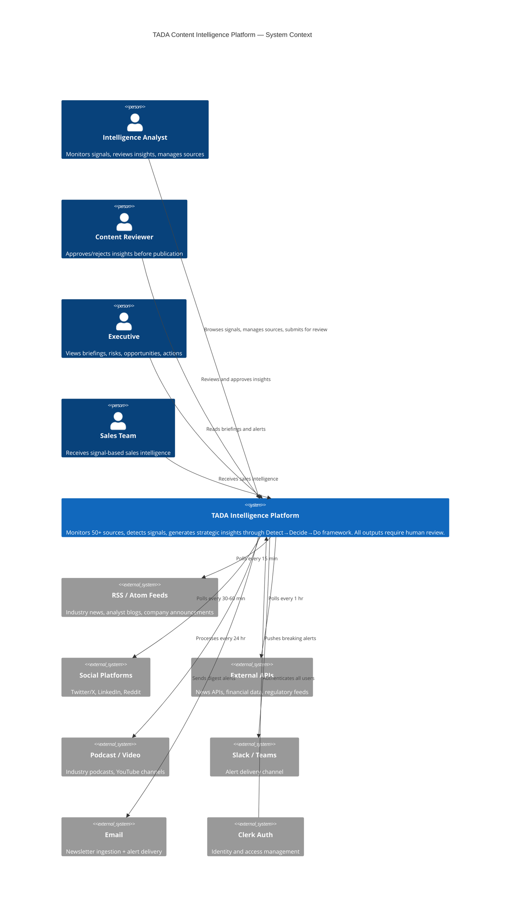
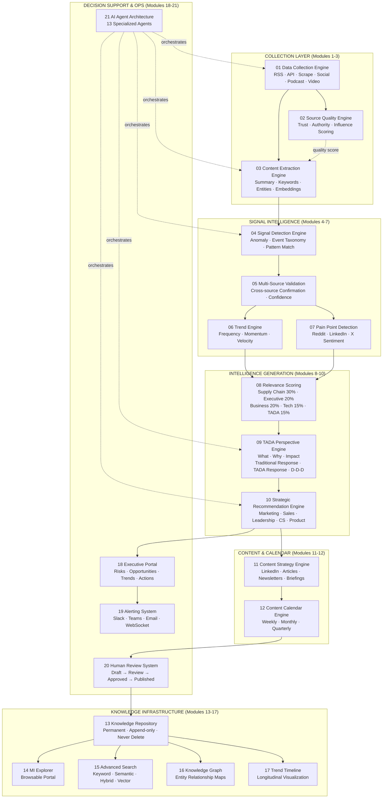
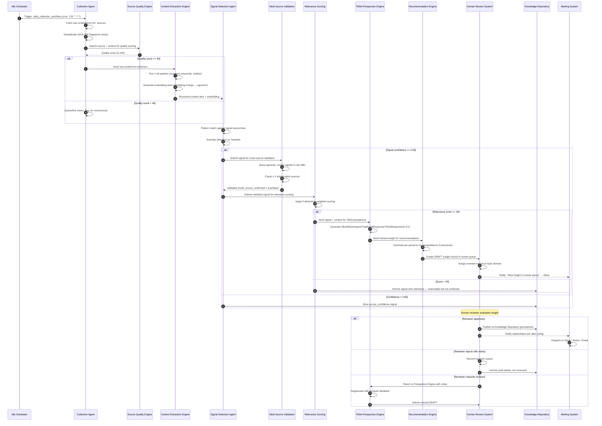
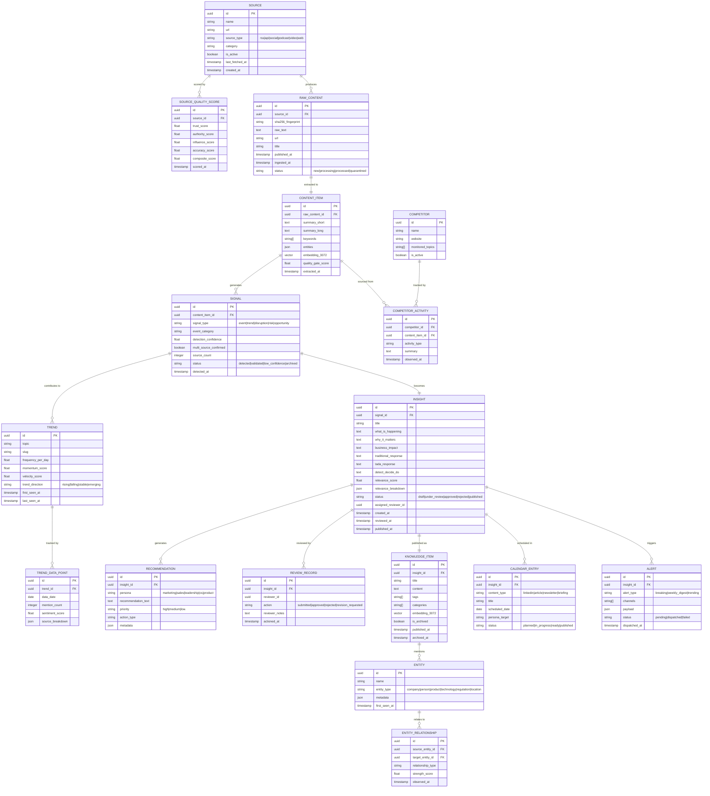
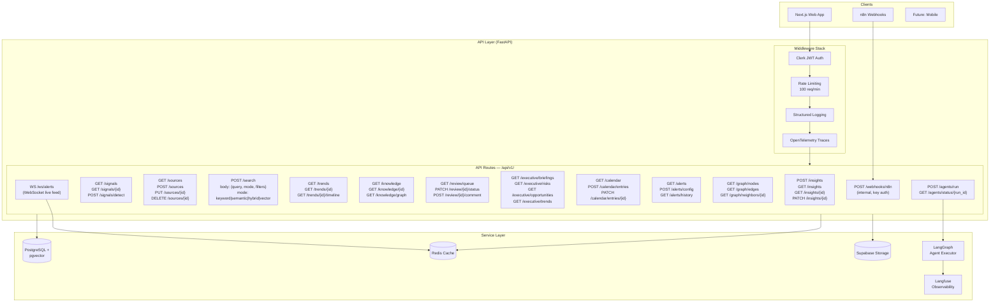
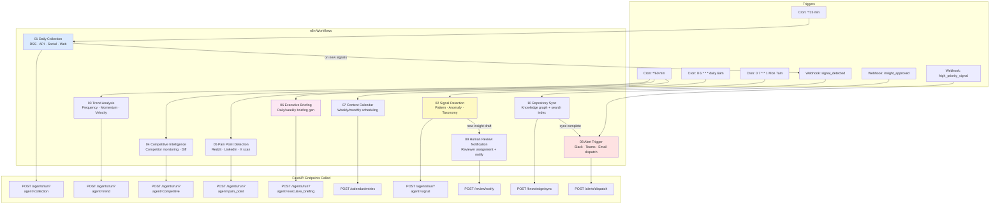

# TADA Content Intelligence Platform — Mermaid Diagrams

**Version:** 1.0.0
**Date:** 2026-06-16

Eight production-grade diagrams covering every architectural dimension of the TADA platform.

---

## Diagram 1: System Overview (C4 Context)



---

## Diagram 2: Module Architecture (Component Diagram)



---

## Diagram 3: Data Flow — Article Ingestion to Published Insight



---

## Diagram 4: AI Agent Architecture

```mermaid
graph LR
    subgraph TRIGGER["Triggers"]
        T1[n8n Webhook]
        T2[API Endpoint]
        T3[Scheduled Cron]
    end

    subgraph ORCHESTRATOR["LangGraph Orchestrator"]
        ORCH[Agent Router<br/>Determines which graph to execute]
    end

    subgraph COLLECTION_GRAPH["Collection Graph"]
        AG_CA[Collection Agent<br/>Fetches from 50+ sources<br/>Tools: fetch_rss, fetch_api, scrape_web]
        AG_RE[Research Agent<br/>Deep-dives on demand<br/>Tools: web_search, read_page, fetch_pdf]
    end

    subgraph SIGNAL_GRAPH["Signal Graph"]
        AG_SD[Signal Detection Agent<br/>Pattern + anomaly detection<br/>Tools: query_vectors, classify_event]
        AG_TR[Trend Agent<br/>Frequency/momentum/velocity<br/>Tools: trend_query, compute_momentum]
        AG_CI[Competitive Intel Agent<br/>Competitor monitoring<br/>Tools: competitor_search, diff_content]
        AG_PP[Pain Point Agent<br/>Community sentiment<br/>Tools: reddit_scan, twitter_scan, linkedin_scan]
    end

    subgraph INTELLIGENCE_GRAPH["Intelligence Graph"]
        AG_PE[TADA Perspective Agent<br/>What/Why/Impact/D-D-D<br/>Tools: generate_perspective, validate_ddd]
        AG_RC[Recommendation Agent<br/>Per-persona strategic recs<br/>Tools: persona_lookup, generate_rec]
        AG_CS[Content Strategy Agent<br/>Content format mapping<br/>Tools: format_content, schedule_slot]
        AG_SA[Sales Agent<br/>Sales intelligence extraction<br/>Tools: crm_lookup, generate_talking_points]
    end

    subgraph BRIEFING_GRAPH["Briefing Graph"]
        AG_EB[Executive Briefing Agent<br/>Weekly/daily briefing compilation<br/>Tools: aggregate_insights, rank_priority]
        AG_QA[QA Agent<br/>Quality and accuracy checking<br/>Tools: fact_check, consistency_check]
        AG_RO[Repository Agent<br/>Knowledge store management<br/>Tools: store_insight, update_graph, index_search]
    end

    T1 --> ORCH
    T2 --> ORCH
    T3 --> ORCH

    ORCH -->|collection trigger| AG_CA
    ORCH -->|research request| AG_RE
    ORCH -->|signal pipeline| AG_SD
    ORCH -->|briefing trigger| AG_EB

    AG_CA -->|raw content| AG_SD
    AG_RE -->|research output| AG_SD
    AG_SD -->|validated signals| AG_TR
    AG_SD -->|validated signals| AG_CI
    AG_SD -->|validated signals| AG_PP
    AG_TR -->|trend data| AG_PE
    AG_CI -->|competitive context| AG_PE
    AG_PP -->|pain point context| AG_PE
    AG_PE -->|framed insight| AG_RC
    AG_PE -->|framed insight| AG_SA
    AG_RC -->|recommendations| AG_CS
    AG_RC -->|recommendations| AG_QA
    AG_CS -->|content plan| AG_QA
    AG_QA -->|validated insight| AG_RO
    AG_EB -->|briefing draft| AG_QA
    AG_RO -->|stored| KR[(Knowledge Repository)]

    style COLLECTION_GRAPH fill:#dbeafe,stroke:#3b82f6
    style SIGNAL_GRAPH fill:#fef9c3,stroke:#eab308
    style INTELLIGENCE_GRAPH fill:#dcfce7,stroke:#22c55e
    style BRIEFING_GRAPH fill:#fce7f3,stroke:#ec4899
```



---

## Diagram 5: Database ERD



---

## Diagram 6: API Architecture



---

## Diagram 7: n8n Workflow Overview



---

## Diagram 8: Deployment Architecture

```mermaid
graph TB
    subgraph INTERNET["Internet / Users"]
        USER_WEB[Web Browser]
        USER_SLACK[Slack / Teams]
        USER_EMAIL[Email Client]
    end

    subgraph VERCEL["Vercel (Frontend CDN + Edge)"]
        VCL_EDGE[Vercel Edge Network<br/>Global CDN]
        VCL_NEXT[Next.js App<br/>SSR + RSC + API Routes]
        VCL_STATIC[Static Assets<br/>CDN-cached]
    end

    subgraph RAILWAY["Railway (Backend Infrastructure)"]
        subgraph RAIL_API["API Service"]
            RW_API[FastAPI App<br/>4 workers · 2GB RAM]
            RW_CELERY[Celery Workers<br/>2 workers · async tasks]
        end

        subgraph RAIL_AGENTS["Agents Service"]
            RW_AGENTS[LangGraph Agent Runner<br/>2 workers · 4GB RAM]
        end

        subgraph RAIL_N8N["Workflow Service"]
            RW_N8N[n8n (self-hosted)<br/>queue mode]
            RW_N8N_WORKER[n8n Worker<br/>2 workers]
        end

        subgraph RAIL_DATA["Data Services"]
            RW_PG[(PostgreSQL 15<br/>+ pgvector extension<br/>+ PgBouncer pool)]
            RW_REDIS[(Redis 7<br/>cache + pub/sub<br/>+ Celery broker)]
        end
    end

    subgraph SUPABASE["Supabase (Storage)"]
        SB_STORAGE[Object Storage<br/>PDFs · Audio · Images]
        SB_AUTH_HOOK[Auth Webhook Receiver]
    end

    subgraph CLERK["Clerk (Auth SaaS)"]
        CL_AUTH[JWT Issuance<br/>User Management<br/>RBAC Roles]
    end

    subgraph OBSERVABILITY["Observability"]
        LF[Langfuse Cloud<br/>AI Traces + Eval]
        PROM[Prometheus<br/>Metrics Scrape]
        GRAF[Grafana Cloud<br/>Dashboards + Alerts]
    end

    subgraph EXTERNAL_APIS["External APIs & Sources"]
        EXT[OpenAI API<br/>Twitter API<br/>Reddit API<br/>Proxycurl<br/>News APIs<br/>YouTube API]
    end

    USER_WEB -->|HTTPS| VCL_EDGE
    VCL_EDGE --> VCL_NEXT
    VCL_NEXT -->|API calls| RW_API
    RW_API -->|async tasks| RW_CELERY
    RW_API -->|agent triggers| RW_AGENTS
    RW_N8N -->|webhooks| RW_API
    RW_N8N --> RW_N8N_WORKER
    RW_API --> RW_PG
    RW_API --> RW_REDIS
    RW_CELERY --> RW_PG
    RW_CELERY --> RW_REDIS
    RW_AGENTS --> RW_PG
    RW_AGENTS --> EXT
    RW_API --> SB_STORAGE
    CL_AUTH -->|JWT| RW_API
    CL_AUTH -->|JWT verify| VCL_NEXT
    RW_AGENTS -->|traces| LF
    RW_API -->|metrics| PROM
    PROM --> GRAF
    RW_API -->|alerts| USER_SLACK
    RW_N8N -->|alerts| USER_SLACK
    RW_N8N -->|alerts| USER_EMAIL

    style VERCEL fill:#000,color:#fff
    style RAILWAY fill:#7c3aed,color:#fff
    style SUPABASE fill:#1a1a2e,color:#fff
    style CLERK fill:#6c47ff,color:#fff
    style OBSERVABILITY fill:#f0fdf4,stroke:#22c55e
```
