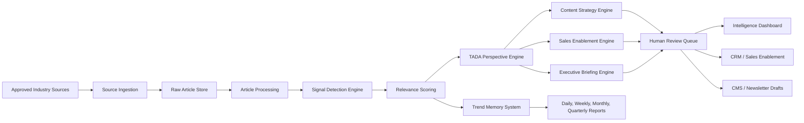

# Full System Architecture

## Executive Summary

TADA's Supply Chain Content Intelligence Platform is a modular intelligence system that converts external market developments into reviewed, actionable content and enablement recommendations. It continuously monitors approved sources, extracts structured insights, detects signals, scores business relevance, applies TADA's strategic point of view, and routes outputs through human review.

The system is designed around four principles:

- Trusted inputs only
- Explainable scoring and evidence
- Detect, Decide, Do alignment
- Human approval before publishing or external use

## Reference Architecture

## Production Modules

### 1. Source Ingestion

Responsibilities:

- RSS polling
- API ingestion
- Website scraping through Firecrawl, Apify, or Bright Data
- Source health checks
- Deduplication by canonical URL and content hash
- Retry handling and logging

Recommended cadence:

- Daily full sweep for all sources
- Hourly check for high-signal sources such as analyst firms, major business publications, and supply chain news
- Manual refresh button for leadership or campaign-driven monitoring

### 2. Article Processing

Processing transforms article text into structured intelligence:

- Short summary
- Medium summary
- Executive summary
- Keywords
- Topics
- Companies
- Industries
- Locations
- Risks
- Opportunities
- Disruptions

Implementation detail:

- Use deterministic extraction for metadata where possible.
- Use LLM extraction for nuanced risk, opportunity, and executive summary fields.
- Store extraction evidence for auditability.

### 3. Signal Detection Engine

The signal engine identifies:

- Emerging trends
- Market shifts
- Economic signals
- Technology adoption
- Supply chain disruptions
- Regulatory changes
- Supplier risks
- Tariff changes
- Inventory trends
- Manufacturing constraints

It should cluster semantically similar signals and track trend velocity across time windows.

### 4. Relevance Scoring

Scoring weights:

- Supply Chain Relevance: 30%
- Executive Importance: 20%
- Business Impact: 20%
- Technology Relevance: 15%
- TADA Alignment: 15%

Surface rules:

- Score >= 7
- High-impact breaking development
- Major analyst report

### 5. TADA Perspective Engine

Every surfaced signal receives:

- What Happened
- Why It Matters
- Potential Impact
- Traditional Response
- TADA Response
- Detect
- Decide
- Do

### 6. Content Strategy Engine

Generates drafts for:

- LinkedIn post idea
- Thought leadership article
- Newsletter topic
- Sales talking point
- Executive briefing

All outputs default to `draft`.

### 7. Trend Memory System

Tracks:

- Historical signals
- Week-over-week movement
- Month-over-month movement
- Quarter-over-quarter movement
- Emerging, stable, and declining trends

### 8. Knowledge Base

Recommended backing store:

- PostgreSQL/Supabase for relational records
- pgvector for semantic search
- Object storage for raw article snapshots
- Optional OpenSearch or Typesense for richer keyword search

### 9. Human Review

Supported states:

- Draft
- Under Review
- Approved
- Rejected
- Published

Each review event captures reviewer, timestamp, status transition, and comments.

### 10. Reporting

Reports:

- Daily Intelligence Digest
- Weekly Strategic Report
- Monthly Executive Summary
- Quarterly Trend Report

## Enterprise Readiness

Scalability:

- Queue-based ingestion and processing
- Stateless workers
- Partition reports by date and source category

Fault tolerance:

- Source-level retry policy
- Dead-letter queue for failed articles
- Idempotent processing by content hash

Explainability:

- Store source URL, article excerpt, extracted evidence, scoring dimensions, and model prompt version

Maintainability:

- Version prompts
- Version scoring rules
- Keep source configuration data-driven

Security:

- Role-based access control
- Secrets in managed vault
- Read-only source connectors
- Full review audit trail

