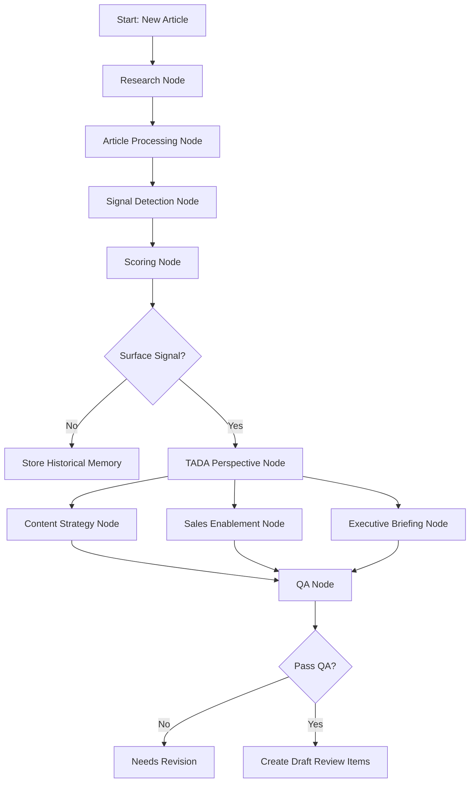

# LangGraph / CrewAI Architecture

## LangGraph Recommended Flow



## LangGraph State

```python
class IntelligenceState(TypedDict):
    article_id: str
    article: dict
    extracted: dict
    candidate_signal: dict
    score: dict
    surfaced: bool
    tada_perspective: dict
    content_opportunities: dict
    sales_talking_points: dict
    executive_briefing: dict
    qa_findings: list[dict]
    review_status: str
```

## Control Rules

- If score < 7 and not breaking and not major analyst report, store in trend memory only.
- If QA finds missing evidence, route to revision.
- If output contains unsupported claims, route to revision.
- All successful generated outputs end in `draft`.

## CrewAI Role Design

Crew:

- Research Agent
- Signal Detection Agent
- Trend Analysis Agent
- TADA Perspective Agent
- Content Strategy Agent
- Sales Enablement Agent
- Executive Briefing Agent
- QA Agent

Recommended CrewAI use cases:

- Generating multiple content angles for a high-scoring signal
- Running a critique round before human review
- Creating weekly strategic synthesis from multiple trend clusters

## Hybrid Recommendation

Use LangGraph for the production pipeline because review states and scoring gates need deterministic control. Use CrewAI-style collaboration inside selected nodes where creative synthesis benefits from multiple perspectives.

