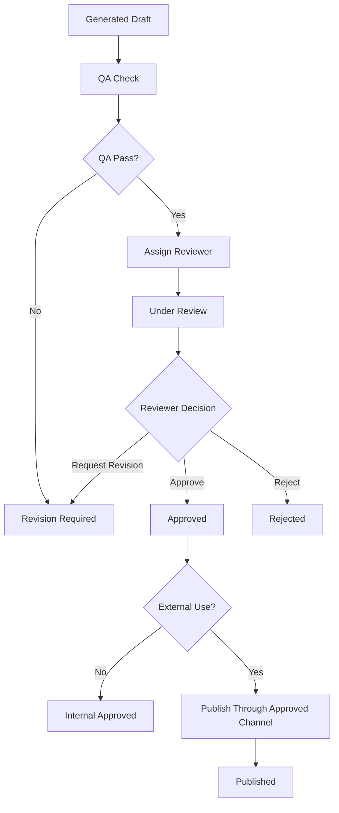

# Review Workflow

## Principle

No generated output is published automatically. The system produces intelligence drafts, recommendations, and content opportunities for humans to review.

## Statuses

- Draft: Created by the system and not yet reviewed
- Under Review: Assigned to a reviewer
- Approved: Accepted for internal use or downstream drafting
- Rejected: Not suitable or requires major changes
- Published: Used externally or distributed through an approved channel

## Review Rules

- Every item must have source evidence.
- Every item must preserve the distinction between source fact and TADA interpretation.
- Every item must align with TADA's Detect, Decide, Do narrative.
- Content opportunities must avoid spam-like urgency or generic AI claims.
- Sales talking points must be consultative and cannot imply knowledge of a specific prospect's internal state.
- Executive briefings must be concise and decision-oriented.

## Reviewer Roles

Marketing reviewer:

- LinkedIn ideas
- Thought leadership drafts
- Newsletter topics
- Editorial calendar recommendations

Sales reviewer:

- Sales talking points
- Discovery questions
- Account conversation themes

Leadership reviewer:

- Executive briefings
- Monthly and quarterly reports
- Major trend interpretations

Platform owner:

- Source approvals
- Prompt and scoring version changes
- QA exception handling

## Workflow

## Audit Trail

Each review event records:

- Entity type
- Entity ID
- Previous status
- New status
- Reviewer
- Timestamp
- Comments

